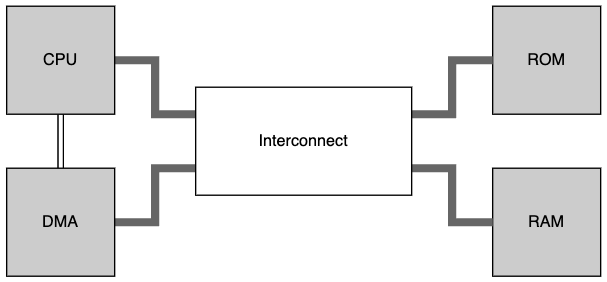
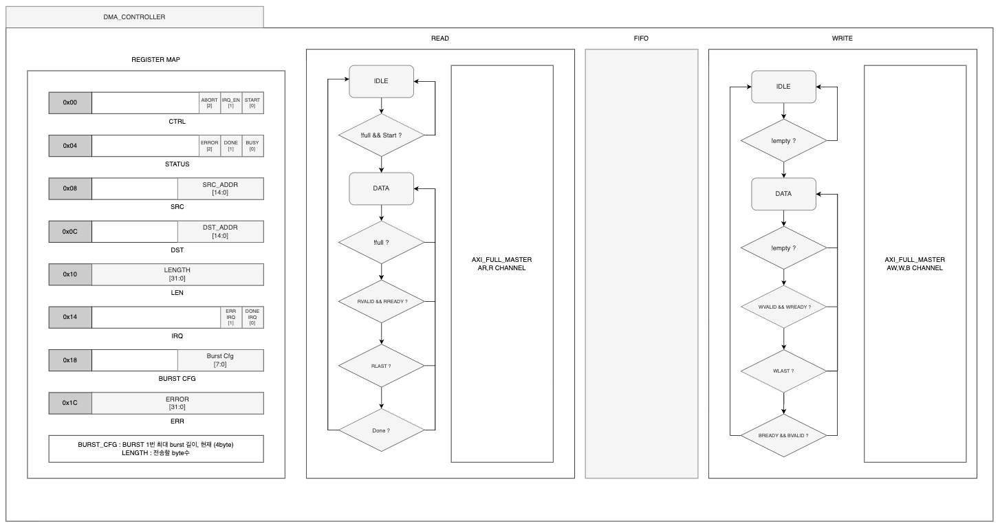
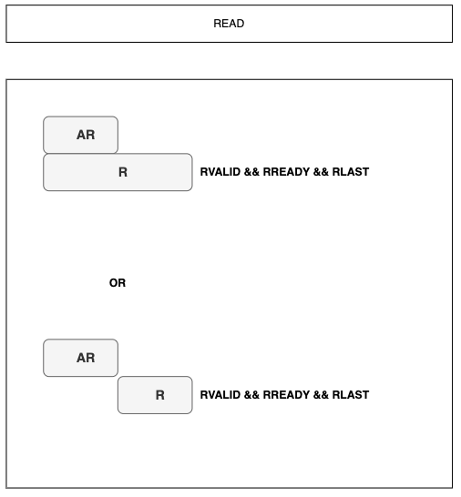
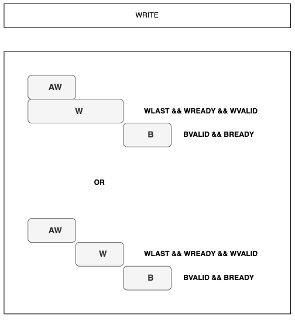
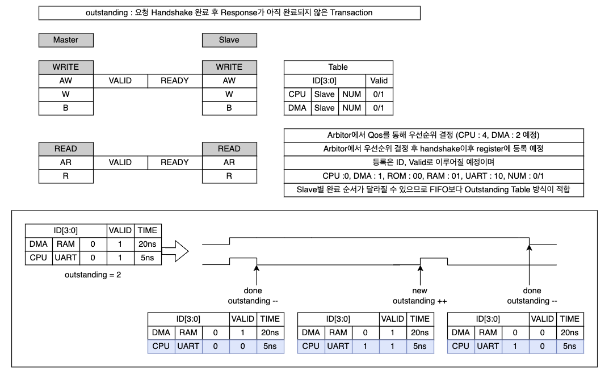
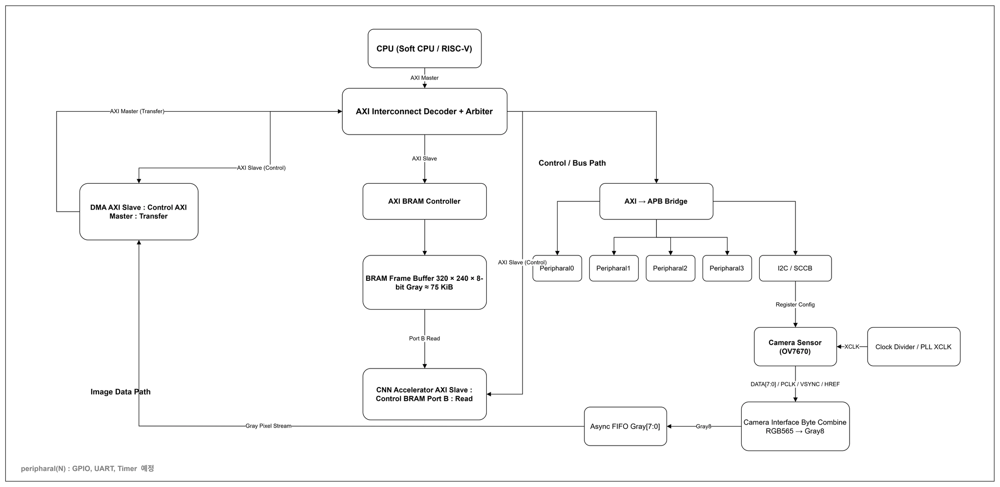

# AXI4 DMA IP

AXI4 Full Burst Transaction으로 메모리 간 데이터를 옮기는 **DMA Controller**와, CPU · DMA 2개 Master가 ROM · RAM을 공유하는 **AXI4 Interconnect**를 Verilog로 설계한 프로젝트입니다.

> 🚧 **진행 중인 프로젝트입니다.** 🚧 <br> RTL 일부(Read / Write Engine, Interconnect)만 공개되어 있으며, 검증 환경과 결과는 완료 후 추가합니다.

| 항목 | 내용 |
|---|---|
| 기간 | 2026.08.11 ~ 2026.08.30 |
| 상태 | 일부 설계까지만 진행 |
| 형태 | 3인 팀 |
| 인터페이스 | AXI4 Full (ID 4-bit, ADDR 15-bit, DATA 32-bit) |
| 언어 | Verilog HDL |

## 시스템 구조

<p align="center">
  
</p>

| 구성 | 역할 |
|---|---|
| CPU / DMA | AXI4 Master. CPU가 DMA Register를 설정하면 DMA가 메모리 간 전송을 수행 |
| Interconnect | 2 Master × 2 Slave 중재, Read / Write 채널 분리 (`AXI_INTERCONNECT_R` / `_W`) |
| ROM / RAM | AXI4 Slave. 주소 MSB(`REGION_LSB = 14`)로 선택, 각 16 KB (ROM `0x0000 ~ 0x3FFF`, RAM `0x4000 ~ 0x7FFF`) |

## DMA Controller

<p align="center">
  
</p>

DMA Controller는 **Register Map → Read Engine → FIFO → Write Engine** 구조입니다.
Read Engine이 FIFO에 쓰고 Write Engine이 FIFO에서 읽기 때문에, 두 방향이 서로의 응답 지연에 묶이지 않습니다.

### Register Map

| Offset | Register | Field |
|---|---|---|
| `0x00` | CTRL | `START[0]` · `IRQ_EN[1]` · `ABORT[2]` |
| `0x04` | STATUS | `BUSY[0]` · `DONE[1]` · `ERROR[2]` |
| `0x08` | SRC | `SRC_ADDR[14:0]` |
| `0x0C` | DST | `DST_ADDR[14:0]` |
| `0x10` | LEN | `LENGTH[31:0]` — 전송할 byte 수 |
| `0x14` | IRQ | `DONE_IRQ[0]` · `ERR_IRQ[1]` |
| `0x18` | BURST_CFG | `Burst Cfg[7:0]` — 1회 최대 Burst 길이 |
| `0x1C` | ERR | `ERROR[31:0]` — 에러 발생 주소 |

### Read / Write Engine FSM

두 Engine 모두 `IDLE ↔ DATA` 2-state FSM으로 동작하고, Control과 Datapath를 분리했습니다.

| Engine | IDLE → DATA | DATA 유지 조건 | DATA → IDLE |
|---|---|---|---|
| Read (AR · R) | `!full && START` | FIFO가 차지 않았고(`!full`) `RVALID && RREADY`로 beat 수신 | `RLAST` 후 전체 전송 `Done` |
| Write (AW · W · B) | `!empty` | FIFO에 데이터가 있고(`!empty`) `WVALID && WREADY`로 beat 송신 | `WLAST` 후 `BVALID && BREADY` |

## AXI4 Transaction 완료 조건

<table>
  <tr>
    <td align="center"></td>
    <td align="center"></td>
  </tr>
  <tr>
    <td align="center">Read: <code>RVALID && RREADY && RLAST</code></td>
    <td align="center">Write: <code>WLAST && WREADY && WVALID</code> → <code>BVALID && BREADY</code></td>
  </tr>
</table>

AXI4는 채널이 독립적이라 R(W)가 AR(AW)과 겹쳐 시작할 수도, 뒤따라 시작할 수도 있습니다.
따라서 Engine은 주소 채널 Handshake 시점이 아니라 **마지막 beat(`RLAST`) / Write 응답(B)** 을 기준으로 Transaction 완료를 판단합니다.

## Interconnect: Outstanding Transaction 관리

<p align="center">
  
</p>

**Outstanding**은 요청 Handshake는 끝났지만 Response가 아직 완료되지 않은 Transaction입니다.
CPU와 DMA가 서로 다른 Slave에 동시에 요청하면 Slave별로 완료 순서가 달라질 수 있어, FIFO 대신 **Outstanding Table** 방식을 택했습니다.

| 항목 | 설계 |
|---|---|
| Table Entry | `ID[3:0]` = Master(CPU `0` / DMA `1`) · Slave(ROM `00` / RAM `01` / UART `10`*) · NUM(`0` / `1`) + `VALID` |
| 등록 / 해제 | 요청 Handshake 후 `VALID = 1`로 등록, Response 완료 시 해제 (`outstanding--`) |
| 최대 개수 | 2개 (예: DMA → RAM과 CPU → UART*가 동시에 진행) |
| 우선순위 | Arbiter에서 QoS로 결정 (CPU `4`, DMA `2`) — 설계 예정 |

\* UART Slave는 이후 확장 예정으로, 현재 구현된 Slave는 ROM · RAM입니다.

## 설계 포인트

| 항목 | 설계 |
|---|---|
| Burst 크기 | 최대 16 B = 4 beat. MicroBlaze D-Cache line(4 word)과 맞춰 이후 cache-fill 경로에서 재분할이 필요 없게 함 |
| Burst Length 계산 | `min(설정 ARLEN, 남은 beat, 4 KB 경계까지 남은 beat)` |
| 4 KB Boundary | 현재 주소에서 다음 4 KB 경계까지의 beat 수를 계산해 경계를 넘지 않도록 Burst 분할 |
| Burst Type | `burst_cfg[9:8]`로 FIXED / INCR 선택 |
| 정렬 정책 | SRC · LENGTH는 4-byte 정렬로 강제 → 모든 beat가 4 byte 유효, Write Engine은 `WSTRB = 4'b1111` 고정 |
| 잘못된 설정 | 정렬 위반 · 처리 불가 Burst 설정은 `cfg_err`로 보고 |
| Error 처리 | `RRESP` / `BRESP` ≠ OKAY 시 `error` 래치 + 실패 Burst의 `error_addr` 기록 |
| Abort | `CTRL.ABORT`로 진행 중 전송 강제 종료 |

## 디렉터리 구조

```text
.
├── DMA_CNTL/
│   ├── Read_Engine/
│   │   ├── read_engine.v          # Read Engine Top
│   │   ├── read_control.v         # IDLE / DATA FSM, busy · done · error
│   │   └── read_datapath.v        # AR 주소 · Burst 계산 · R 수신 → FIFO
│   └── Write_Engine/
│       ├── axi4_write_engine.v
│       ├── axi4_write_controller.v
│       └── axi4_write_datapath.v  # FIFO → AW / W, B 응답 처리
├── AXI4_Full/
│   ├── AXI_INTERCONNECT_TOP.v     # CPU · DMA 2 Master × ROM · RAM 2 Slave
│   ├── AXI_INTERCONNECT_R.v       # Read 채널 중재
│   ├── AXI_INTERCONNECT_W.v       # Write 채널 중재
│   ├── axi_slave_ROM.v
│   └── axi_slave_RAM.v
└── docs/                          # README 다이어그램
```

## 진행 계획

| 단계 | 내용 | 상태 |
|---|---|---|
| RTL | Read / Write Engine, AXI4 Interconnect | 진행 중 |
| RTL | DMA Top, 내부 FIFO, AXI4-Lite CSR(SRC · DST · LEN · START · STATUS · IRQ) | 예정 |

### 확장 구상

DMA와 Interconnect를 기반으로 카메라 영상 입력부터 CNN 가속기까지 연결하는 SoC로 확장할 계획이었습니다.

<p align="center">
  
</p>
